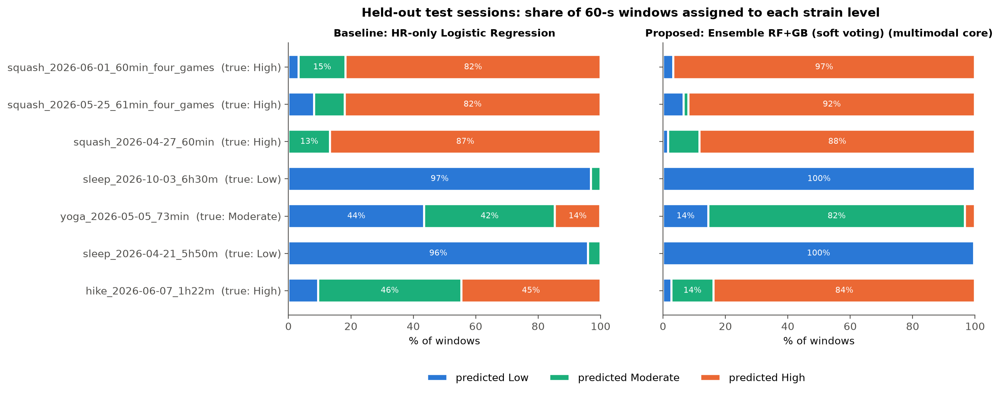
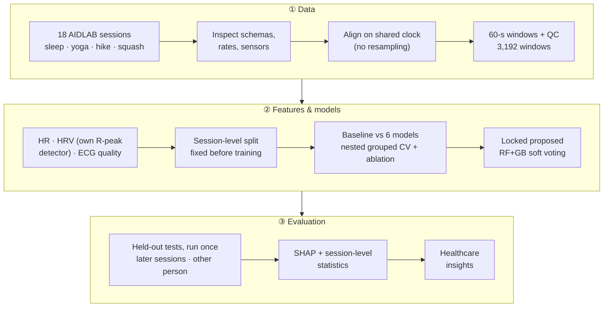
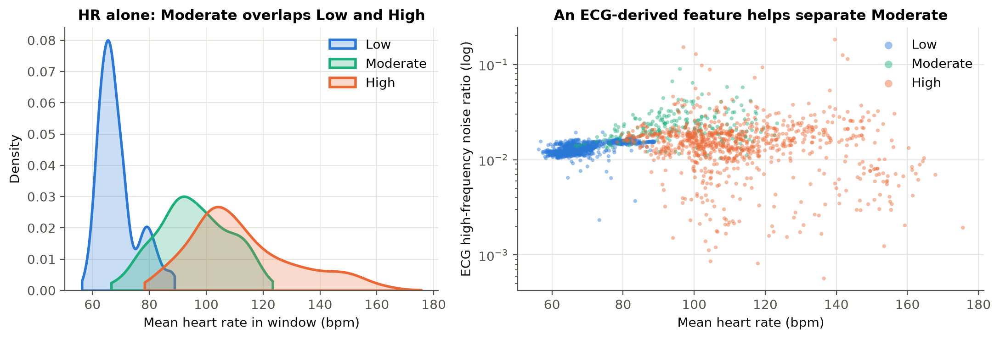
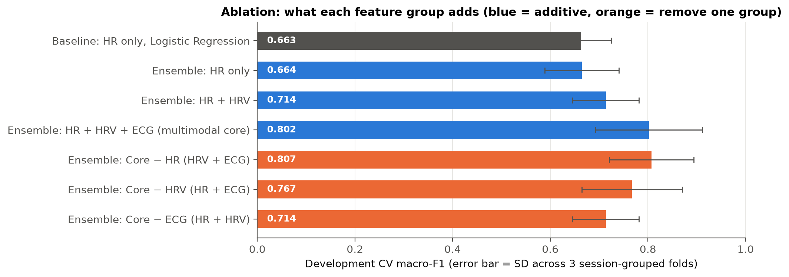
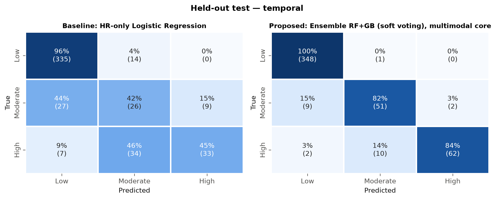
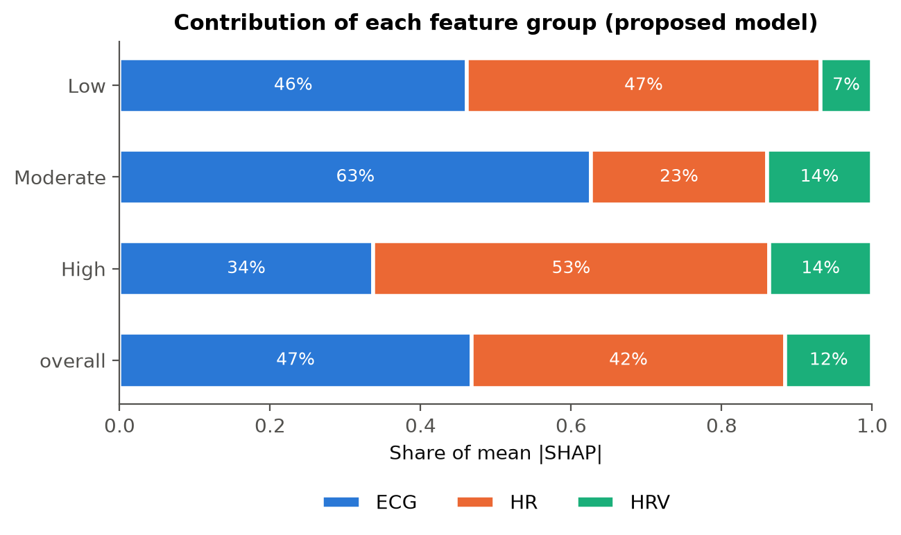
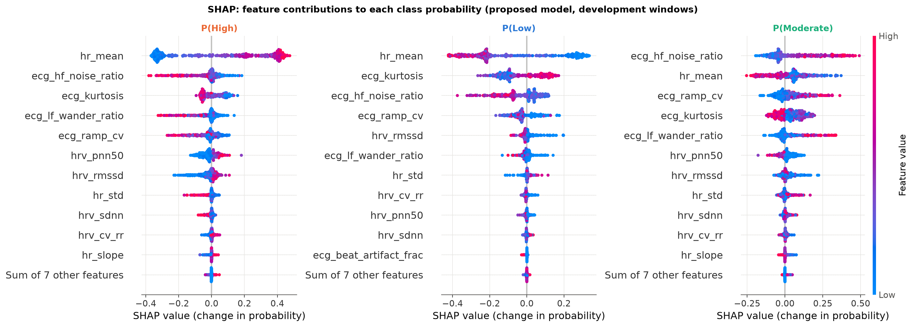
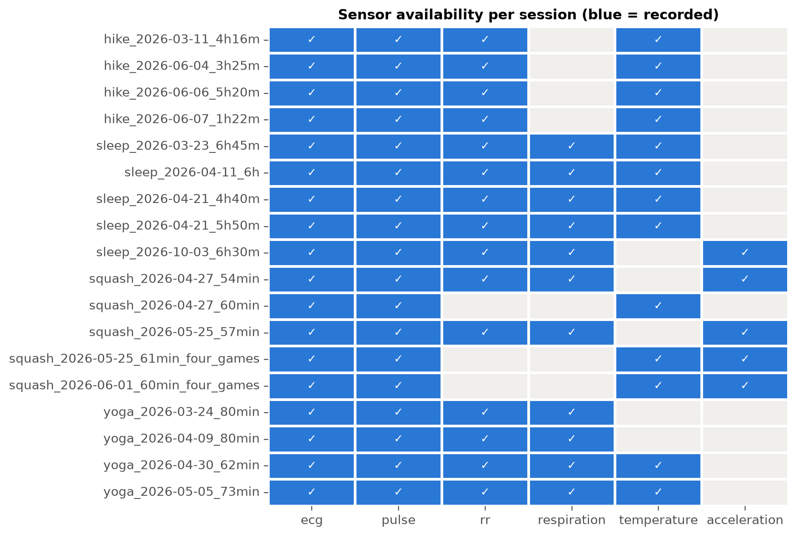

<div align="center">

# Multimodal Wearable Sensor Fusion for Physiological Strain Stratification

**A Hybrid HRV-Based Risk Monitoring Approach**

*Can a chest-strap wearable tell how hard the body is working better by fusing several signals than by using heart rate alone?*

[](https://colab.research.google.com/github/hardikjain2005/Multimodal-Wearable-Sensor-Fusion-for-Physiological-Strain-Stratification/blob/main/notebooks/run_on_colab.ipynb)
[](https://www.python.org/)
[](https://scikit-learn.org/)
[](https://github.com/shap/shap)
[](https://aidlab.com/datasets)
[](LICENSE)
[](#-reproducibility)



<sub>Held-out recordings the model never saw. With heart rate alone, yoga is split between Low and Moderate and the hike between Moderate and High; the multimodal ensemble assigns most minutes of each session to the correct level.</sub>

</div>

> [!IMPORTANT]
> This is a **healthcare analytics** project, **not a medical device**. The model estimates
> *activity-derived* physiological strain categories (Low / Moderate / High) from wearable biosignals.
> The labels are proxies taken from the activity being performed (sleep, yoga, hike, squash), not
> clinical diagnoses.

---

## 📌 At a glance

| | HR-only baseline<br><sub>Logistic Regression</sub> | **Proposed**<br><sub>RF + GB soft-voting ensemble · HR + HRV + ECG features</sub> | Δ |
|---|:---:|:---:|:---:|
| Development cross-validation, macro-F1 <sub>(session-grouped, nested)</sub> | 0.663 | **0.802** | +0.139 |
| Development cross-validation, macro ROC-AUC | 0.874 | **0.960** | +0.086 |
| **Held-out test: later sessions**, macro-F1 <sub>(same person, 3 classes)</sub> | 0.628 | **0.901** | +0.273 |
| **Held-out test: different person**, macro-F1 <sub>(Low vs High only)</sub> | 0.943 | **0.975** | +0.032 |
| Moderate-strain recall, later-sessions test | 0.42 | **0.82** | +0.40 |

**Key findings**

- 🫀 **Multimodal fusion clearly beats heart rate alone.** Giving HR to stronger algorithms does not
  help (0.648–0.671 macro-F1 for every model); adding HRV and ECG features does (up to 0.802).
- 🧪 **Ablation shows where the gain comes from.**
  - ECG signal-quality/motion features contribute the most: removing them drops macro-F1 to 0.714.
  - HRV adds a smaller amount: removing it drops macro-F1 to 0.767.
  - The ensemble itself adds little over a single Gradient Boosting model (0.802 vs 0.800).
- 🔍 **SHAP:** ECG features account for 47 % of the model's attention, HR for 42 % and HRV for 12 %.
  Mean HR drives High; ECG high-frequency noise drives Moderate.
- ⚠️ **HRV did not fall with strain in this data.** Chest movement corrupts beat timing during squash
  and inflates RMSSD, which is an important caveat for wearable HRV during sport.

---

## 🧭 Pipeline



<details>
<summary><b>Why session-grouped evaluation matters</b></summary>

Neighbouring 60-second windows from the same recording are nearly identical. With ordinary random
K-fold, windows of one session land in both the training and test folds, so the model is tested on
data it has effectively seen and accuracy is inflated. Here every session is entirely in training *or*
in test:

- cross-validation folds are grouped by session;
- hyperparameters are tuned in an inner loop that is also grouped by session (nested CV);
- the two held-out test sets were fixed in [`docs/analysis_plan.md`](docs/analysis_plan.md) before any
  model was trained, and each was evaluated exactly once.

</details>

---

## 📊 Results

<table>
<tr>
<td width="50%"><br><sub><b>Why HR alone fails.</b> Yoga (Moderate) overlaps sleep and hiking in heart rate; at the same HR, yoga shows more high-frequency ECG noise.</sub></td>
<td width="50%"><br><sub><b>Ablation.</b> HR → +HRV → +ECG, and leave-one-group-out. ECG features add the most.</sub></td>
</tr>
<tr>
<td width="50%"><br><sub><b>Held-out later sessions.</b> Row-normalised confusion matrices: baseline vs proposed.</sub></td>
<td width="50%"><br><sub><b>Explainability.</b> Share of mean |SHAP| by feature group, per class.</sub></td>
</tr>
</table>

<p align="center"></p>

<details>
<summary><b>Full development cross-validation table</b> (pooled out-of-fold, macro-averaged)</summary>

| Model | Feature set | Accuracy | Precision | Recall | F1 | F1 fold SD | ROC-AUC |
|---|---|:---:|:---:|:---:|:---:|:---:|:---:|
| Logistic Regression (baseline) | HR only | 0.742 | 0.693 | 0.699 | 0.663 | 0.062 | 0.874 |
| Decision Tree | HR only | 0.718 | 0.691 | 0.691 | 0.648 | 0.093 | 0.878 |
| Random Forest | HR only | 0.775 | 0.680 | 0.687 | 0.671 | 0.069 | 0.889 |
| Gradient Boosting | HR only | 0.771 | 0.669 | 0.677 | 0.663 | 0.077 | 0.881 |
| Ensemble (soft voting) | HR only | 0.776 | 0.670 | 0.676 | 0.664 | 0.076 | 0.890 |
| Ensemble (stacking) | HR only | 0.746 | 0.683 | 0.684 | 0.657 | 0.059 | 0.862 |
| Logistic Regression | HR + HRV | 0.760 | 0.720 | 0.750 | 0.692 | 0.013 | 0.928 |
| Decision Tree | HR + HRV | 0.716 | 0.726 | 0.742 | 0.663 | 0.060 | 0.901 |
| Random Forest | HR + HRV | 0.782 | 0.716 | 0.745 | 0.703 | 0.075 | 0.922 |
| Gradient Boosting | HR + HRV | 0.807 | 0.714 | 0.735 | 0.710 | 0.065 | 0.905 |
| Ensemble (soft voting) | HR + HRV | 0.806 | 0.718 | 0.743 | 0.714 | 0.068 | 0.922 |
| Ensemble (stacking) | HR + HRV | 0.777 | 0.726 | 0.754 | 0.703 | 0.061 | 0.907 |
| Logistic Regression | HR + HRV + ECG | 0.832 | 0.760 | 0.825 | 0.766 | 0.053 | 0.936 |
| Decision Tree | HR + HRV + ECG | 0.677 | 0.691 | 0.677 | 0.618 | 0.111 | 0.867 |
| Random Forest | HR + HRV + ECG | 0.826 | 0.749 | 0.802 | 0.759 | 0.112 | 0.956 |
| Gradient Boosting | HR + HRV + ECG | 0.848 | 0.789 | 0.822 | 0.800 | 0.109 | 0.951 |
| **Ensemble (soft voting), proposed** | HR + HRV + ECG | **0.850** | **0.791** | **0.824** | **0.802** | 0.109 | **0.960** |
| Ensemble (stacking) | HR + HRV + ECG | 0.830 | 0.756 | 0.814 | 0.769 | 0.091 | 0.919 |

Source: [`results/metrics/table_cv_comparison.csv`](results/metrics/table_cv_comparison.csv).
The held-out test results for every model are in
[`results/metrics/test_results.csv`](results/metrics/test_results.csv).

</details>

<details>
<summary><b>Additional experiments</b> (imbalance handling, respiration and temperature add-ons)</summary>

| Experiment | Result |
|---|---|
| Class imbalance (proposed model, CV macro-F1) | class weights **0.802** · no correction 0.799 · SMOTE (training folds only) 0.787 |
| Respiration add-on (sleep/yoga/squash sessions only, 2-fold grouped CV) | core 0.819 → core + respiration 0.826 (negligible; fold SD ≈ 0.12) |
| Temperature add-on (pre-declared; evaluated on later-sessions test) | core 0.840 → core + temperature 0.924; tentative, because temperature also reflects bedding/environment and Moderate training data came from one session |

</details>

---

## 🗂️ Data

Source: **[AIDLAB wearable datasets](https://aidlab.com/datasets)**, chest-strap recordings with the
following streams:

- 250 Hz ECG
- beat-to-beat RR intervals and heart rate
- 50 Hz respiration impedance
- skin temperature
- accelerometer

Raw data is **not** redistributed here. Download it with `scripts/download_data.py`.

| Split | Sessions | 60-s windows (Low / Moderate / High) |
|---|---|:---:|
| Development | 11 (one participant: 3 sleep, 3 yoga, 3 hike, 2 squash) | 1044 / 218 / 874 |
| Test: later sessions | 3 (last sleep, yoga and hike of the same participant) | 349 / 62 / 74 |
| Test: different person | 4 (3 squash of a second participant + 1 sleep without subject metadata) | 390 / – / 181 |

Labels: **sleep → Low · yoga → Moderate · squash & hike → High** (activity-derived proxies).

<p align="center"></p>

<sub>Sensor availability differs by activity: for example, respiration is missing in every hike. Imputing
it would leak the label, so the main model uses only signals present in every session. Full inspection:
[`docs/phase1_dataset_inspection.md`](docs/phase1_dataset_inspection.md).
**AIDLAB-HAR v3** was inspected but not used for evaluation: it contains only motion data with
exercise-type labels, so it cannot test a physiological model.</sub>

---

## 🔬 Method

| Step | What was done |
|---|---|
| **Alignment** | Each stream keeps its native rate. All streams are cut on the same 60-s, non-overlapping windows of the shared Unix-ms clock; nothing is resampled. |
| **HR features (baseline)** | 9 statistics of device heart rate: mean, median, min, max, SD, range, P10, P90, slope. |
| **HRV features** | SDNN, RMSSD, pNN50 and CV-RR, from our own simplified Pan-Tompkins R-peak detector on the raw ECG. RR is cleaned at session level (300–2000 ms range; >20 % deviation from the local median removed). The detector matches the device's RR (r ≥ 0.94 at rest). Mean RR is excluded because it equals 60000/HR. LF/HF is not used: windows are too short and exercise is non-stationary. |
| **ECG quality / motion features** | Kurtosis, high-frequency noise ratio (50 Hz mains band excluded), baseline-wander ratio, R-amplitude variability, beat-artifact fraction. |
| **Models** | Logistic Regression, Decision Tree, Random Forest, Gradient Boosting (HistGradientBoosting), and RF + GB **soft voting** and **stacking** ensembles. Class weights handle imbalance; the correlation filter and scaling are fitted inside training folds only. |
| **Selection** | The proposed model was the ensemble with the higher development-CV macro-F1, chosen *before* testing. |
| **Statistics** | Kruskal-Wallis on **session medians**, not windows (avoiding pseudo-replication), with Holm-corrected post-hoc tests. |
| **Explainability** | Model-agnostic SHAP permutation explainer on the whole ensemble, in probability space. |

---

## 🚀 Quickstart

**No setup:** [](https://colab.research.google.com/github/hardikjain2005/Multimodal-Wearable-Sensor-Fusion-for-Physiological-Strain-Stratification/blob/main/notebooks/run_on_colab.ipynb)
The notebook has two paths:

- **Explore the results:** about 1 minute, with no data download.
- **Reproduce everything:** downloads the AIDLAB data and reruns the full pipeline on Colab.

**Run locally:**

```bash
git clone https://github.com/hardikjain2005/Multimodal-Wearable-Sensor-Fusion-for-Physiological-Strain-Stratification.git
```

```bash
cd Multimodal-Wearable-Sensor-Fusion-for-Physiological-Strain-Stratification
```

```bash
python3 -m venv .venv && .venv/bin/pip install -r requirements.txt
```

```bash
.venv/bin/python scripts/download_data.py
```

```bash
.venv/bin/python main.py --stage all
```

| Stage | Output |
|---|---|
| `data` | window table, quality control, data-understanding figures, signal validation |
| `stats` | feature quality, correlation, session-level Kruskal-Wallis tests |
| `models` | all cross-validation experiments (main, ablation, imbalance, respiration add-on) |
| `report` | comparison tables and cross-validation figures |
| `test` | locked models, evaluated once on both held-out test sets, plus the temperature add-on |
| `explain` | SHAP values and plots |
| `insights` | healthcare-insight figures |

### ♻️ Reproducibility

- Seed 42 everywhere.
- The full run takes about 7 minutes on an Apple-silicon laptop.
- Two independent end-to-end runs produced **byte-identical** metric files.
- Tested with Python 3.13.9; exact package versions are in [`requirements.txt`](requirements.txt).

---

## 📁 Repository structure

```text
├── main.py                     # pipeline entry point (stages above)
├── src/
│   ├── config.py               # paths, seed, window length, label mapping
│   ├── data_loader.py          # AIDLAB session loader (two metadata schemas)
│   ├── preprocessing.py        # alignment, windowing, per-session feature extraction
│   ├── feature_engineering.py  # HR, R-peak detection, HRV, ECG quality, respiration, temperature
│   ├── build_dataset.py        # window table + label-blind quality control
│   ├── splits.py               # fixed session-level development / test split
│   ├── baseline_model.py       # HR-only logistic regression
│   ├── ensemble_model.py       # comparison models + soft-voting / stacking ensembles
│   ├── evaluation.py           # grouped folds, nested CV, metrics, correlation filter
│   ├── statistics.py           # session-level Kruskal-Wallis + Holm post-hoc
│   └── visualization.py        # all figures
├── notebooks/run_on_colab.ipynb  # one-click Colab: explore results or reproduce everything
├── scripts/                    # data download + dataset inspection scripts
├── docs/                       # dataset inspection findings, pre-registered analysis plan
├── report/                     # project report (.docx), report builder, presentation outline
└── results/
    ├── figures/                # every figure
    ├── metrics/                # every table behind every reported number
    └── models/                 # HR-only baseline + proposed ensemble (others regenerate)
```

---

## ⚠️ Limitations

1. Activity is a **proxy** for strain; there are no clinically validated labels, and results are not a diagnosis.
2. Development and the later-sessions test come from **one participant**; the different-person test has one other person, who performed only squash.
3. Sensors differ between sessions, so respiration, temperature and accelerometer data stay **outside the main model**.
4. **Motion artifacts** affect HRV and respiration during vigorous activity.
5. ECG quality features partly reflect movement and recording conditions, not only physiology.
6. With 11 development sessions, statistical power is low, and cross-validation scores vary by about ±0.1 between folds.

---

## 📄 Report & presentation

- Full project report:
  [`report/Wearable_Strain_Stratification_Report.docx`](report/Wearable_Strain_Stratification_Report.docx)
- 15-slide outline with speaker notes:
  [`report/presentation_outline.md`](report/presentation_outline.md)

## 📚 Key references

- Task Force of ESC/NASPE (1996). *Heart rate variability: standards of measurement, physiological interpretation, and clinical use.* Circulation 93(5).
- Pan, J. & Tompkins, W. J. (1985). *A real-time QRS detection algorithm.* IEEE Trans. Biomed. Eng. 32(3).
- Saeb, S. et al. (2017). *The need to approximate the use-case in clinical machine learning.* GigaScience 6(5).
- Lundberg, S. M. & Lee, S.-I. (2017). *A unified approach to interpreting model predictions.* NeurIPS.
- Czekaj, Ł. et al. (2024). *Real-time sensor-based human activity recognition for eFitness and eHealth platforms.* Sensors 24(12):3891.

The full list of 21 references is in the report.

## ⚖️ License

- **Code:** [MIT](LICENSE).
- **Data:** not included.
  - AIDLAB-HAR v3 is CC BY 4.0.
  - The sleep session of 2026-10-03 is MIT.
  - The other AIDLAB session archives state no licence, so they are referenced rather than redistributed.

<div align="center"><sub>Healthcare Analytics Mini Project · Hardik Jain · Course instructor: Dr. Prerna</sub></div>
